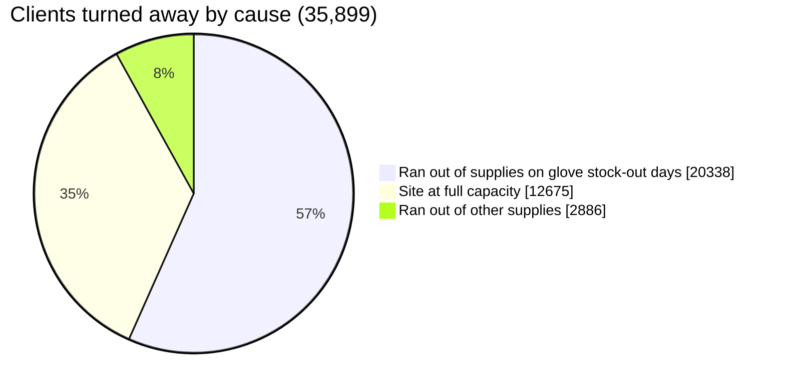
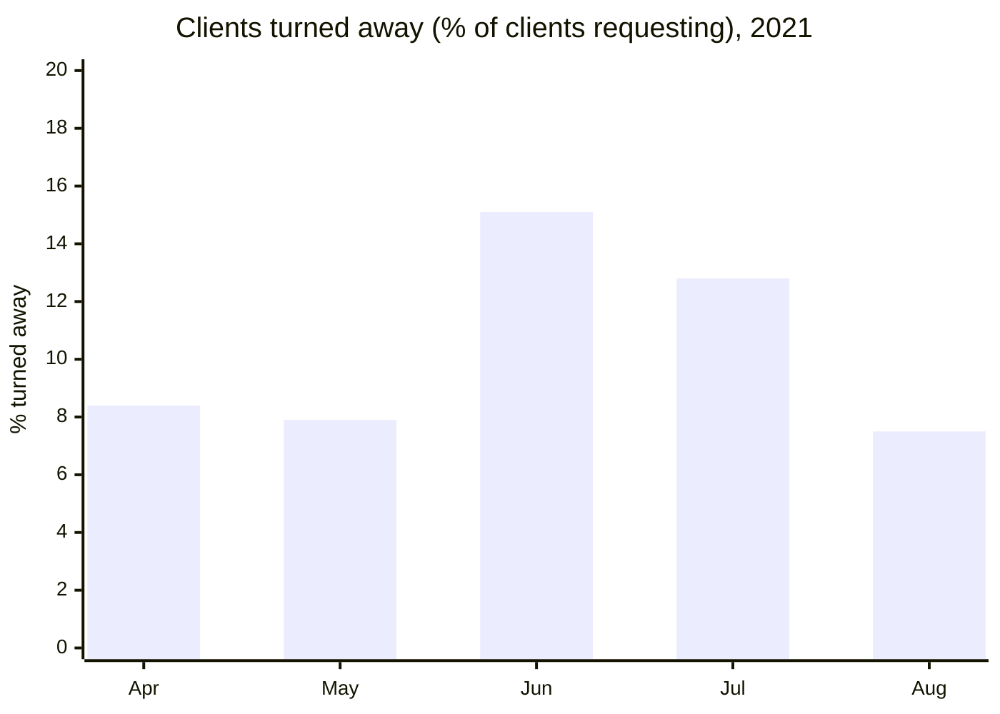

# 💉 Vaccine Site Logistics Analysis

**Why were clients turned away from mobile COVID-19 vaccination clinics, and how could better inventory planning have prevented it?**

> ⚠️ **Sample data.** Every site, supplier, quantity and date in this project is **synthetic**, generated to resemble the kind of multi-site clinic logistics I supported with the Canadian Red Cross (2020–2022). It contains no real Red Cross, client or supplier data.

**Tools:** SQL (SQLite) · Power BI (dashboard design)

---

## Key results

- **11.8% of clients were turned away** (35,899 of 303,760).
- **65% of turn-aways were caused by running out of supplies**, not by sites reaching capacity. **88%** of those happened on days a site had **run out of nitrile gloves**. Vaccine itself ran out on only 17 site-days.
- **NorthPath Medical** (gloves and masks) delivered on time only **58.7%** of the time, versus 91–93% for the other suppliers.
- **Weekly Monday ordering couldn't keep up with demand.** Saturday demand was 37% higher than on weekdays, and turn-aways reached **18.6%** during the June–July surge.
- **Recommended fix:** daily reorder-point checks (about **2,560 pairs** of gloves at the busiest site, versus ~1,500 ordered weekly), a backup glove supplier, and extra Saturday and surge staffing.

Full write-up: **[findings/FINDINGS.md](findings/FINDINGS.md)**

---

## Results

### Why clients were turned away

### Turn-aways peaked during the June–July surge

### One supplier was late 4 times in 10

| Supplier | Supplies | On-time delivery | Avg lead time (promised) | Fill rate |
|---|---|---|---|---|
| **NorthPath Medical** | Gloves, surgical masks | **58.7%** | **4.4 days (3)**, max 8 | 98.4% |
| Lakeshore Safety Products | N95s, gowns | 91.6% | 4.1 days (4) | 98.4% |
| Provincial Vaccine Depot | Vaccine | 91.1% | 2.1 days (2) | 98.2% |
| Maple Medical Supply | Syringes, swabs, sharps | 93.2% | 3.1 days (3) | 98.4% |

### Stock-out days by item

| Item | Supplier | Stock-out site-days |
|---|---|---|
| Surgical masks | NorthPath | **184** |
| Nitrile gloves | NorthPath | **151** |
| Sharps containers | Maple | 138 |
| Isolation gowns | Lakeshore | 67 |
| N95 respirators | Lakeshore | 65 |
| Syringes / swabs | Maple | 19 / 17 |
| Vaccine (both products) | Provincial | 17 |

### Vaccine wastage

Small sites (100 or fewer doses a day) wasted **5.7%** of their vaccine, versus **1.5%** at larger sites.

### Recommended reorder points: Malton Mobile clinic (busiest site)

| Item | Avg / max daily use | Avg / max lead time | Safety stock | **Reorder point** |
|---|---|---|---|---|
| Nitrile gloves | 239 / 320 | 4.4 / 8 days | 1,515 | **2,560** |
| Syringes 1 mL | 232 / 315 | 3.1 / 4 days | 547 | **1,260** |
| mRNA vaccine – Product A | 133 / 180 | 2.1 / 3 days | 263 | **540** |
| mRNA vaccine – Product B | 89 / 120 | 2.1 / 3 days | 174 | **360** |

*Method: safety stock = (max daily use × max lead time) − (avg daily use × avg lead time); reorder point = avg daily use × avg lead time + safety stock.*

---

## The scenario

A network of **32 mobile and pop-up vaccination sites** across York, Peel, Toronto, Durham and Halton ran from April to August 2021. Each site received vaccine, syringes, swabs and PPE from **4 suppliers**, reordered **once a week (Mondays)** based on the previous week's use, and was staffed from a pool of **13 responders**.

## Business questions

1. Where and when was demand highest? Did sites have enough capacity?
2. Which suppliers delivered late or short, and did that cause stock-outs?
3. Which items ran out most often, and did a stock-out stop vaccinations?
4. How much vaccine was wasted, and at which kinds of sites?
5. What reorder points and safety stock would have prevented the stock-outs?

---

## Repository contents

| Path | What it is |
|---|---|
| `data/` | 8 CSV files (synthetic) |
| `sql/00_create_database.sql` | Creates the SQLite tables; steps to import the CSVs |
| `sql/01_explore.sql` | Demand by region, site, day of week and month |
| `sql/02_kpis.sql` | On-time delivery, fill rate, stock-outs, wastage, turn-away causes |
| `sql/03_reorder_points.sql` | Lead times, safety stock and reorder points |
| `findings/FINDINGS.md` | Findings and recommendations |
| `dashboard/DASHBOARD_BRIEF.md` | One-page Power BI dashboard design |

## The data

| Table | Rows | One row = |
|---|---|---|
| `sites` | 32 | a clinic site: region, type, daily capacity, open/close dates |
| `items` | 9 | a stocked item: vaccine, PPE or medical supply, plus its supplier |
| `suppliers` | 4 | a supplier and its promised lead time (days) |
| `responders` | 13 | a responder and their role |
| `daily_site_operations` | 1,921 | one site on one day: clients requesting, doses given, clients turned away |
| `daily_inventory` | 17,289 | one item at one site on one day: opening, received, used, wasted, closing |
| `deliveries` | 2,665 | one order: order date, expected date, delivered date, qty ordered vs received |
| `responder_shifts` | 8,481 | one responder working one shift at one site |

## How to reproduce

1. Download this repo (**Code → Download ZIP**) and install **[DB Browser for SQLite](https://sqlitebrowser.org/)** (free).
2. Build the database by following the steps at the top of `sql/00_create_database.sql`.
3. Run the queries in `sql/01`–`03` in the **Execute SQL** tab. Each query's expected result is noted in its comment.
